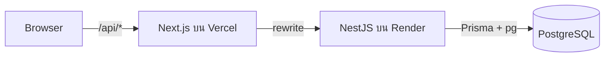

# เกมสะสมคะแนน Nextzy

เว็บแอปเกมสะสมคะแนน
ผู้เล่นสามารถ
- กดสุ่มคะแนน
- สะสมคะแนนไปถึง checkpoint ทั้ง 3 ระดับ(5000, 7500, 10000) 
- กดรับรางวัลได้ ตามระดับ checkpoint

โปรเจคนี้ เป็นแบบทดสอบสำหรับตำแหน่ง Fullstack Engineer ที่ Nextzy

## Links

| | |
|---|---|
| **Live app** | https://nextzy-point-collecting-game.vercel.app |
| **API documentation (Apidog, with "Try it out")** | https://zrtxkfa0b3.apidog.io |
| **OpenAPI spec** | https://nextzy-point-collecting-game-backend.onrender.com/api/docs-json |
| **Repository** | https://github.com/nookarin/nextzy-point-collecting-game |

> **หมายเหตุ:** backend ถูก deploy บน Render แบบฟรี ซึ่งถ้าหากไม่มีการใช้งานสักพัก ตัวเซิร์ฟเวอร์จะถูกปิด การเปิดใหม่จะใช้เวลาค่อนข้างนาน แก้ปัญหาโดยการใช้ UptimeRobot monitor ลิ้ง backend (api/health) ทุกๆ 5 นาที ไม่ให้ตัวเซิร์ฟเวอร์ของเรนเดอร์ถูกปิดลง

> **การทดลองยิง API:** ทุก endpoint ในกลุ่ม Player, Game และ Reward ต้องส่ง header `x-player-id` ที่เป็น UUID ใน Apidog ให้วาง UUID ใดก็ได้ในช่อง **Credentials** ระบบจะสร้างผู้เล่นให้อัตโนมัติเมื่อเรียก API ครั้งแรก สามารถทดลอง UUID นี้ได้เช่นกัน ( 0a1bdd5c-cb80-4897-b125-c53cdfb0a6c8 ) 

---

## วิธีการใช้งานแบบ local

**สิ่งที่ต้องมี:** Node.js 24 และ PostgreSQL database (เช่น Prisma Postgres)

```bash
# 1. ติดตั้ง dependency ของ root, backend และ frontend (รันที่ root แค่ครั้งเดียว)
npm install

# 2. ตั้งค่า database
cp backend/.env.example backend/.env
#    แล้วใส่ DATABASE_URL ใน backend/.env

# 3. สร้างตารางและ seed checkpoint ทั้ง 3 ระดับ
cd backend
npx prisma migrate deploy
npm run db:seed
cd ..

# 4. รันที่ root เพิ่อเริ่มการทดสอบ frontend และ backend (รันที่ root แค่ครั้งเดียว)
npm run dev
```

- Frontend: http://localhost:3000
- Backend: http://localhost:4000/api/health
- OpenAPI spec: http://localhost:4000/api/docs-json

Next.js จะส่งต่อ `/api/*` ไปที่ `http://localhost:4000` (ใน production จะใช้ environment variable `BACKEND_URL`)

## Features

**Home page**
- แสดงคะแนนสะสม (0 ถึง 10000) และ progress bar พร้อม checkpoint 3 ระดับ คือ 5000, 7500 และ 10000
- แต่ละ checkpoint มี 3 สถานะ คือ **locked**, **claimable** และ **claimed** รางวัลที่กดรับได้จะรับได้เพียงครั้งเดียว เมื่อรับสำเร็จจะแสดง modal ยืนยันการรับรางวัลและไม่สามารถรับซ้ำได้อีก
- ปุ่ม **RESET** ล้างคะแนน ประวัติการเล่น และประวัติรางวัลของผู้เล่น เพื่อเริ่มทดสอบใหม่ได้
- แท็บประวัติ 2 แท็บ มี **ประวัติการเล่น** และ **ประวัติรางวัล** ซึ่งจะโชว์คะแนนที่ได้ในแต่ละรอบ และรางวัลที่ claim ไปแล้ว โดยเรียงจากล่าสุดก่อน

**Game page**
- แสดงคะแนนทั้ง 4 ค่า คือ 300, 500, 1000 และ 3000
- เมื่อกด **สุ่มคะแนน** คะแนนจะค่อยๆ หายไปทีละตัวจนเหลือคะแนนที่ได้รับ แล้วแสดง modal บอกคะแนนที่ได้
- คะแนนที่ได้จะถูกบวกเข้าคะแนนสะสม (สูงสุด 10000) ผู้เล่นยังอยู่ที่หน้าเดิมและเล่นต่อได้ทันที กี่ครั้งก็ได้

**ทั้งแอป**
- ดีไซน์แบบ responsive รองรับหน้าจอกว้าง 300px ถึง 500px ตามดีไซน์ตัวอย่างใน Figma

---

## Tech stack

| Layer | Technology |
|---|---|
| Frontend | Next.js 16 (App Router), React 19, Tailwind CSS 4, TypeScript |
| Backend | NestJS 12, TypeScript (ESM) |
| Database | PostgreSQL (Prisma Postgres) กับ Prisma ORM 7 และ driver adapter `@prisma/adapter-pg` |
| เอกสาร API | สร้าง OpenAPI ด้วย `@nestjs/swagger` และเผยแพร่ผ่าน Apidog |
| Hosting | Frontend บน Vercel, Backend บน Render, Database บน Prisma Postgres |

---

## Architecture



### Frontend

```
frontend/src/
├── app/                # ไฟล์ route
├── features/
│   ├── home/           # การ์ดคะแนน, progress bar, ปุ่มรับรางวัล, แท็บประวัติ
│   └── game/           # หน้าเกม, state machine ของแต่ละรอบ, ปุ่มคะแนน
├── components/ui/      # component ที่ใช้ร่วมกัน: ปุ่ม, modal, และอื่นๆ
├── hooks/              # useApiQuery, useApiMutation
└── lib/
    ├── api/            # type ที่สร้างจาก OpenAPI, API client, ข้อความ error
    ├── player-id.ts
    └── format.ts       # จัดรูปแบบตัวเลขและวันเวลา
```

- **API client ตัวเดียว** ใส่ header ของผู้เล่นให้อัตโนมัติ แปลงความผิดพลาดทุกแบบเป็น `ApiError` และแปลง error code เป็นข้อความ
- **Hook 2 ตัว** จัดการ loading, error, การโหลดใหม่ และ race condition ของข้อมูลทั้งหมด โดยไม่ต้องเพิ่ม library สำหรับ data fetching

---

### Backend

```
backend/src/
├── domain/                  # โดเมน
│   ├── score.ts             # ค่าคะแนนที่สุ่มได้, การสุ่ม, cap 10,000
│   ├── checkpoint.ts        # locked / claimable / claimed
│   └── errors.ts            # error 
├── modules/                 # โมดูล แยกโฟลเดอร์ตามฟีเจอร์
│   ├── player/              # สถานะ, ประวัติ, reset
│   ├── game/                # การเล่นเกม
│   ├── reward/              # รับรางวัล
│   └── health/              # เช็ค status ของ api
├── infrastructure/database/ # PrismaService, PrismaModule
└── common/                  # decorator @PlayerId(), exception filter, การตั้งค่า Swagger
```

**การจัดการ error:** domain จะ throw error (`RewardAlreadyClaimedError`, `CheckpointLockedError`, `CheckpointNotFoundError`) แล้วมี exception filter กลางเพียงตัวเดียวที่แปลงเป็น HTTP status code (409, 422, 404)

## Key design decisions

1. **ผู้เล่นที่เปิดเว็บไซต์มาครั้งแรก** เบราว์เซอร์สร้าง UUID ครั้งเดียวแล้วเก็บไว้ backend จะสร้างผู้เล่นให้เมื่อเรียกครั้งแรก การ reset คือการลบผู้เล่นและประวัติทั้งหมด
2. **รางวัลรับได้เพียงครั้งเดียวเท่านั้น** use case ตรวจสอบก่อนเพื่อตอบ error ที่เข้าใจง่าย และมี unique constraint บน `(player_id, checkpoint_id)` ทำให้รับซ้ำไม่ได้แม้มี request เข้ามาพร้อมกัน
3. **คะแนนไม่หายเมื่อเล่นพร้อมกัน** การเล่นแต่ละรอบทำงานใน transaction ที่ lock แถวของผู้เล่น (`SELECT ... FOR UPDATE`) ทำให้การกดเล่นติดๆ กันไม่เขียนทับคะแนนของกันและกัน
4. **สถานะ checkpoint คำนวณที่ backend** frontend แค่แสดงผล `locked / claimable / claimed` และเงื่อนไขการรับรางวัลกับสถานะของปุ่มใช้ฟังก์ชันใน domain ตัวเดียวกัน

---

## API

ทุก path ขึ้นต้นด้วย `/api` endpoint ของผู้เล่นต้องส่ง header `x-player-id` (UUID)

| Method | Endpoint | คำอธิบาย | Response |
|---|---|---|---|
| GET | `/health` | ตรวจสอบสถานะ API และ database | 200 |
| GET | `/players/me` | คะแนน, คะแนนสูงสุด และสถานะ checkpoint | 200, 400 |
| GET | `/players/me/plays` | ประวัติการเล่น เรียงจากล่าสุด | 200, 400 |
| GET | `/players/me/rewards` | ประวัติรางวัล เรียงจากล่าสุด | 200, 400 |
| POST | `/players/me/plays` | เล่นหนึ่งรอบ (เซิร์ฟเวอร์เป็นผู้สุ่มคะแนน) | 201, 400 |
| POST | `/players/me/checkpoints/:checkpointId/claim` | รับรางวัลของ checkpoint | 201, 400, 404, 409, 422 |
| POST | `/players/me/reset` | ลบคะแนน ประวัติการเล่น และประวัติรางวัลของผู้เล่น | 204, 400 |

Error ทุกตัวมีรูปแบบเดียวกัน: `{ "statusCode": 409, "error": "RewardAlreadyClaimedError", "message": "..." }`

### Data model

| Table | Purpose |
|---|---|
| `players` | ผู้เล่นคนละหนึ่งแถว: `id` (UUID) และ `score` |
| `checkpoints` | checkpoint ทั้ง 3 ระดับ (seed ไว้): คะแนนที่ต้องถึงและชื่อรางวัล |
| `play_histories` | หนึ่งแถวต่อการเล่นหนึ่งรอบ มี index บน `(player_id, created_at)` |
| `reward_claims` | หนึ่งแถวต่อการรับรางวัลหนึ่งครั้ง มี unique บน `(player_id, checkpoint_id)` |

---

### Environment variables

| App | Variable | Purpose |
|---|---|---|
| backend | `DATABASE_URL` | connection string ของ PostgreSQL |
| backend | `PORT` | port ที่ใช้รัน (ค่าเริ่มต้น 4000 และ Render กำหนดให้อัตโนมัติ) |
| frontend | `BACKEND_URL` | URL ของ backend สำหรับ rewrite `/api` (ค่าเริ่มต้น `http://localhost:4000`) |

### Useful scripts

| Where | Command | Purpose |
|---|---|---|
| root | `npm run dev` | รัน backend และ frontend พร้อมกัน |
| backend | `npm test` | unit test |
| backend | `npm run test:e2e` | end-to-end test กับแอปและ database จริง |
| backend | `npm run db:studio` | เปิด Prisma Studio เพื่อดูข้อมูล |
| frontend | `npm run api:types` | สร้าง type ของ API ใหม่จาก backend ที่กำลังรัน |

---

## Deployment

- **Frontend:** Vercel ตั้ง Root Directory เป็น `frontend` และตั้ง `BACKEND_URL` เป็น URL ของ backend
- **Backend:** Render ตั้ง Root Directory เป็น `backend` และ health check ที่ `/api/health`
- **Database:** Prisma Postgres

---

## Performance

| **PageSpeed Result** | https://pagespeed.web.dev/analysis/https-nextzy-point-collecting-game-vercel-app/m1jk6s0b73?form_factor=mobile |

